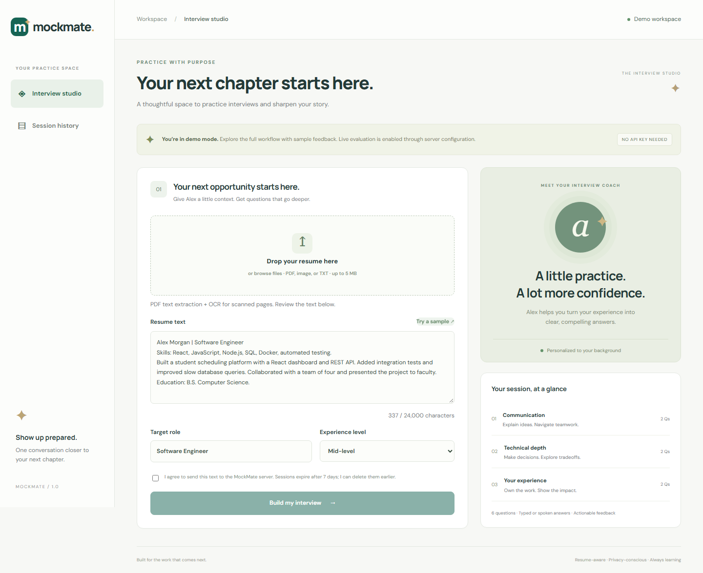
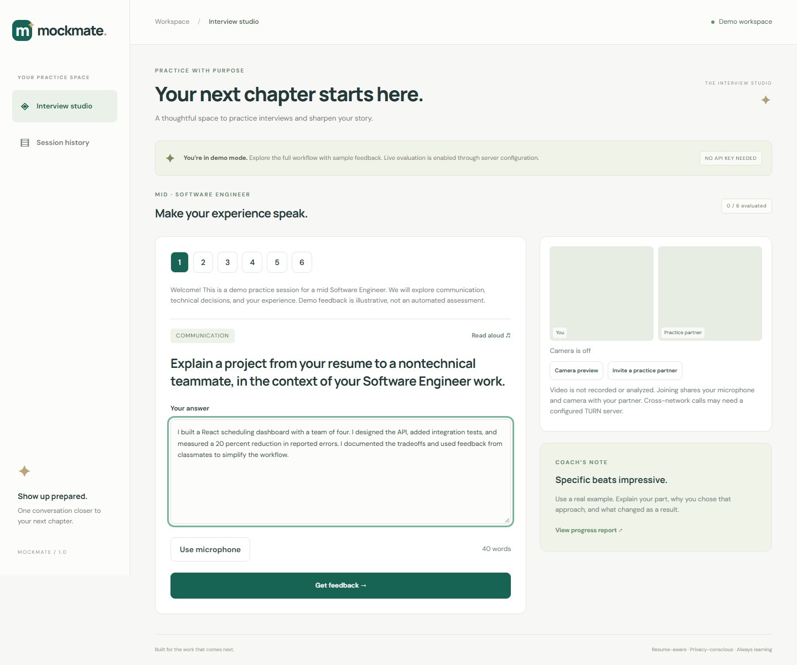
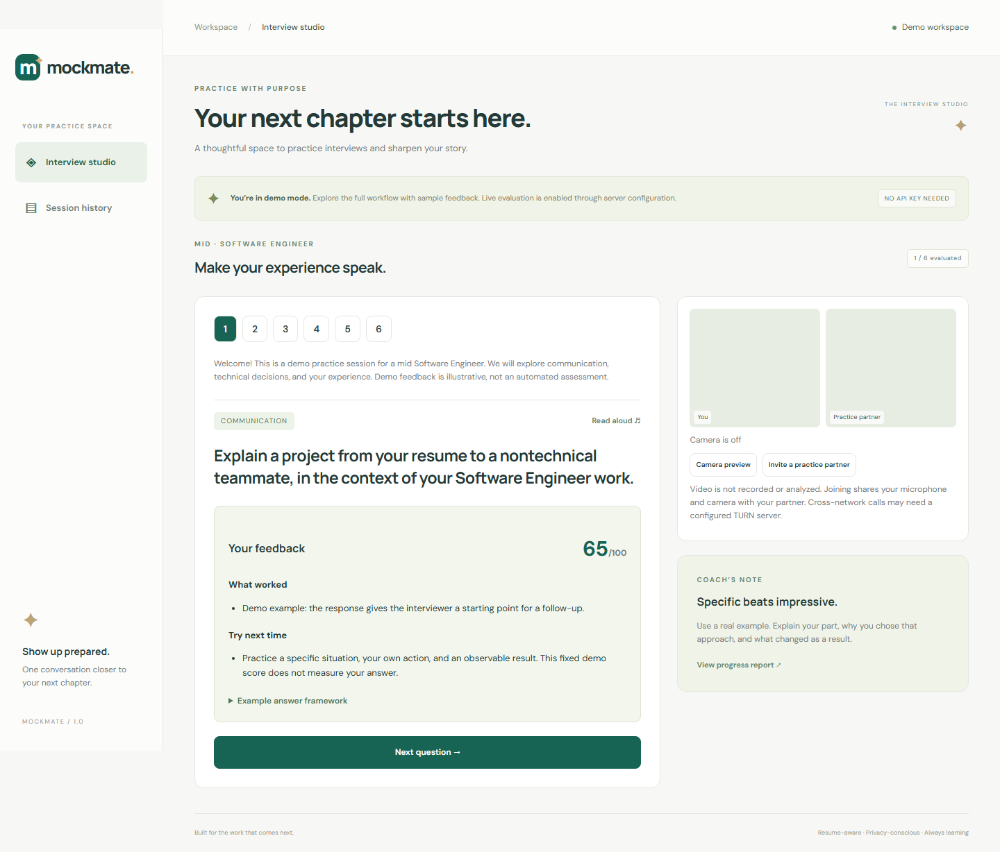
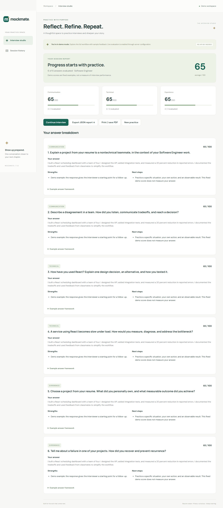
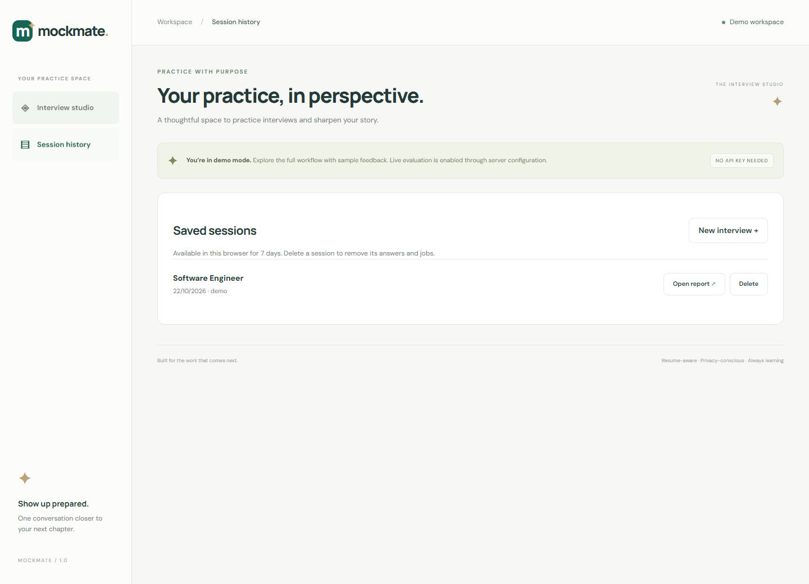
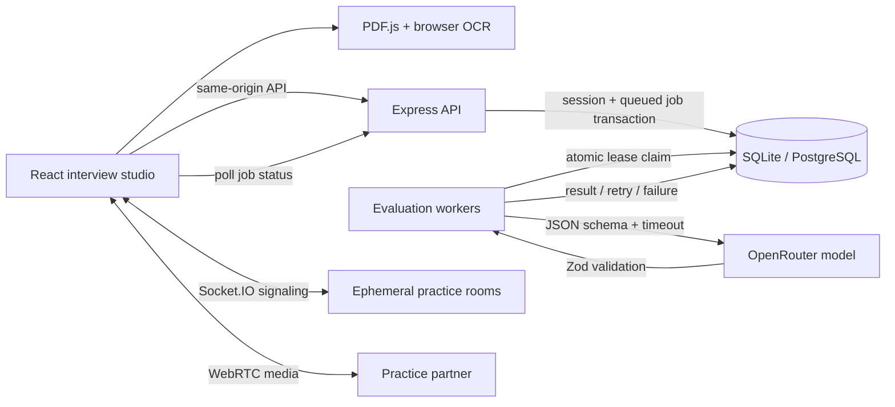

<div align="center">

# MockMate

### Your experience. A better story. Your next opportunity.

A full-stack interview and assessment studio with résumé parsing, OCR, durable evaluation workers, live peer practice, and a repeatable delivery pipeline.

[](https://github.com/Shreeya1807/MockMate/actions/workflows/ci.yml)
[](https://github.com/Shreeya1807/MockMate/actions/workflows/security.yml)

**React + Vite · Node.js + Express · SQLite / PostgreSQL · OpenRouter · WebRTC · Docker · GitHub Actions**

</div>

[**Open MockMate**](https://mockmate-nu2x.onrender.com) · Free hosting may need about a minute to wake after inactivity. The hosted app uses a free live evaluator; provider quotas apply. Local demo mode remains available.



MockMate turns a résumé into six interview questions, evaluates answers against a structured rubric, and produces a report you can revisit or export. It runs without an API key in an explicitly labeled demo mode. Live mode uses a server-side OpenRouter integration with schema-validated model output.

## Start in two minutes

Requires **Node.js 22.20+** and npm. The Node 22 built-in SQLite API may print an experimental-feature warning.

```bash
git clone https://github.com/Shreeya1807/MockMate.git
cd MockMate
npm ci
npm run dev
```

Open **http://localhost:5173**. Choose **Try a sample**, review the consent checkbox, and build your interview. No account, API key, Docker, or separate database server is required for the demo. Use `localhost` consistently, because origin checks distinguish it from `127.0.0.1`.

## Walk through a working session

These screenshots were captured from the running application using the included sample résumé and a complete six-answer session. **Local demo mode is shown: scores and feedback are illustrative fixtures.** The hosted application uses live evaluation, subject to provider availability.

### 1. Practice a personalized question

Review the question category and write an answer. Speech and peer-practice controls are available alongside the interview.



### 2. Review structured feedback

See strengths, improvements, and an answer framework before moving to the next question.



### 3. Review and export the completed report

The report shows completion and category scores. Export the session as JSON or print it to PDF.



### 4. Revisit previous sessions

Open saved reports or delete sessions from the same browser.



For a quick review, run the sample journey above, then inspect the [queue and storage design](docs/ARCHITECTURE.md), [API contracts](docs/API.md), and [test/deployment runs](https://github.com/Shreeya1807/MockMate/actions/workflows/ci.yml).

## What you can do

- **Bring your résumé:** paste text or upload PDF, TXT, PNG, or JPEG. PDF.js extracts text; Tesseract performs English OCR on images and scanned pages. Review the extracted text before sending it. Limits: 5 MB, 10 PDF pages, 24,000 characters.
- **Practice for your role:** choose a target role and seniority. Each plan contains two communication, two technical, and two experience questions.
- **Answer your way:** type, dictate with supported browser speech recognition, or listen to questions with text-to-speech. Typed answers always work without microphone access.
- **Get structured feedback:** receive a score, strengths, improvements, and an example-answer framework. Category averages are calculated from actual completed evaluations; unfinished work is clearly labeled.
- **Practice with a person:** create a private invite for a two-person WebRTC audio/video room. Socket.IO relays signaling; media travels over the peer connection or configured TURN relay. Webcam preview alone stays local.
- **Keep your progress:** revisit sessions in the same browser, export JSON, print/save a report as PDF, or delete a session. Sessions expire after seven days.

## Engineering behind the experience

| Concern             | Implementation                                                                                                                                             |
| ------------------- | ---------------------------------------------------------------------------------------------------------------------------------------------------------- |
| Durable async work  | SQLite/PostgreSQL-backed jobs, separate worker entry point, atomic claims, restart recovery                                                                |
| Bounded retries     | Three attempts maximum, exponential backoff with jitter, 60-second leases, 25-second provider timeout                                                      |
| Provider limits     | Shared call pacing, `Retry-After` cooldown, 100-job backlog cap, request and submission rate limits                                                        |
| Duplicate requests  | One evaluation per session/question; repeated identical answers return the same job; conflicting submissions return 409                                    |
| Output integrity    | Strict JSON-schema request plus Zod validation, sequential question IDs, category distribution checks, bounded score/text fields                           |
| Server-side secrets | No `VITE_*` model key; only the server calls the evaluation provider                                                                                       |
| Session isolation   | Random HttpOnly, SameSite browser capability; only its SHA-256 hash is stored; ownership checked on every session/job read                                 |
| Operations          | Liveness/readiness probes, worker heartbeat, JSON request logs, protected Prometheus metrics, online backup command                                        |
| Delivery            | Lint + formatting + API regressions + real browser tests + dependency audit + container smoke tests; GHCR releases and optional verified Render deployment |



See [architecture and design decisions](docs/ARCHITECTURE.md), [API reference](docs/API.md), and [operations runbook](docs/OPERATIONS.md).

## Enable live evaluation

Copy `.env.example` to `.env` (`Copy-Item .env.example .env` in PowerShell), then set:

```dotenv
EVALUATION_MODE=live
OPENROUTER_API_KEY=your-server-side-key
OPENROUTER_MODEL=your-structured-output-capable-model
APP_ORIGIN=http://localhost:5173
```

Restart the server. Select a model/provider that supports [OpenRouter structured outputs](https://openrouter.ai/docs/guides/features/structured-outputs). Unsupported or invalid responses fail explicitly; the app never silently replaces failed live evaluations with fake scores. Existing demo jobs are not sent to the provider after switching modes.

**Demo feedback is a fixed illustrative example, not a model evaluation.** Live scoring is coaching guidance, not a hiring decision or a validated psychometric assessment. No live provider claim is made without testing your configured credentials/model.

## Build and run

```bash
npm run build
```

Set `APP_ORIGIN=http://localhost:3001` in `.env`, then run `npm start` and visit that URL. The server serves the Vite build and API on one origin.

For isolated API and worker containers, use Docker Compose 2.24+:

```bash
docker compose up --build -d --wait
```

Open **http://localhost:3001**. If `.env` exists, set its `APP_ORIGIN` to that URL first. Compose uses a persistent named volume, non-root processes, read-only container roots, health probes, dropped capabilities, and resource limits. It binds only to loopback; put an HTTPS reverse proxy in front for remote access. See the runbook before changing proxy trust or deploying publicly.

## Quality gates

```bash
npm run check
npx playwright install chromium
npm run test:e2e
npm audit --audit-level=high
```

The tests cover the full interview/report/history/delete journey, mobile layout, real PDF parsing, real image/scanned-PDF OCR, and a two-peer WebRTC connection with simulated camera devices. API tests cover ownership isolation, idempotency, schema violations, retry exhaustion, provider errors, leases, pacing, retention, readiness, and rate limits. OCR tests download public language/engine assets and therefore require network access.

GitHub Actions additionally tests the PostgreSQL adapter against PostgreSQL 17 and builds and starts the API/worker containers. Local PostgreSQL contract tests use embedded PGlite; CI tests real concurrent server connections. CodeQL runs separately, and Dependabot checks dependencies and action versions. Browser traces and screenshots are uploaded when CI runs. A green local test run does not imply that remote Actions or a cloud deployment have already run.

## CI/CD

1. **Push or PR:** quality, PostgreSQL and container smoke checks run. A dependent GitHub Actions job deploys the tested main revision through the Render API and verifies public readiness.
2. **Version tag (`v*`) or manual release:** all checks rerun, then a container is published to GHCR with a commit-specific `sha-…` tag.
3. **Optional production delivery:** configure the `production` GitHub environment, `RENDER_DEPLOY_HOOK` and `PRODUCTION_HEALTH_URL` secrets, and `DEPLOY_ENABLED=true`. The workflow asks Render to deploy the tested Git SHA, then verifies both readiness and the deployed revision.

`render.yaml` provides a free Render web-service blueprint backed by an external Neon PostgreSQL database. Sessions persist across web-service restarts; free-tier sleep and usage quotas apply. See the runbook for account setup and verification. GHCR is a distributable image; the supplied Render workflow rebuilds the same verified commit. [Deployment and rollback instructions →](docs/OPERATIONS.md)

## Project map

```text
src/                    React studio, reports, media controls, PDF/OCR extraction
server/app.js           HTTP API, validation, ownership, rate limits, probes
server/contracts.js     Shared server-side data contracts and output constraints
server/provider.js      Live evaluation gateway and explicit demo fixtures
server/store.js         Local SQLite sessions, queue, transactions and leases
server/postgres-store.js Hosted PostgreSQL persistence and queue locking
server/worker.js        Bounded evaluation workers and graceful shutdown
server/signaling.js     Two-participant, expiring WebRTC signaling rooms
tests/                  API/queue regressions and browser workflows
scripts/backup.js        Consistent online SQLite backup
.github/workflows/      Quality, security, image publishing and optional deployment
docs/                   Architecture, API and operations
```

## Scope and tradeoffs

This is a deployable, single-host portfolio application. SQLite/WAL keeps setup and operations simple; it is **not a distributed queue**. Run one API process per deployment. Local workers share a disk; hosted workers share PostgreSQL. Moving to multiple API replicas requires shared rate limiting, durable distributed signaling, and coordinated worker capacity. No enterprise accounts, billing, ATS integration, proctoring, recording, or hiring automation are claimed.

Speech recognition varies by browser and may use its vendor's cloud service. Video across restrictive networks requires TURN; demo/local peer tests do not prove connectivity across every NAT. Resumes and answers are sensitive: read the [security/privacy notes](SECURITY.md). Clear browser cookies and you lose access to that browser's retained sessions.
