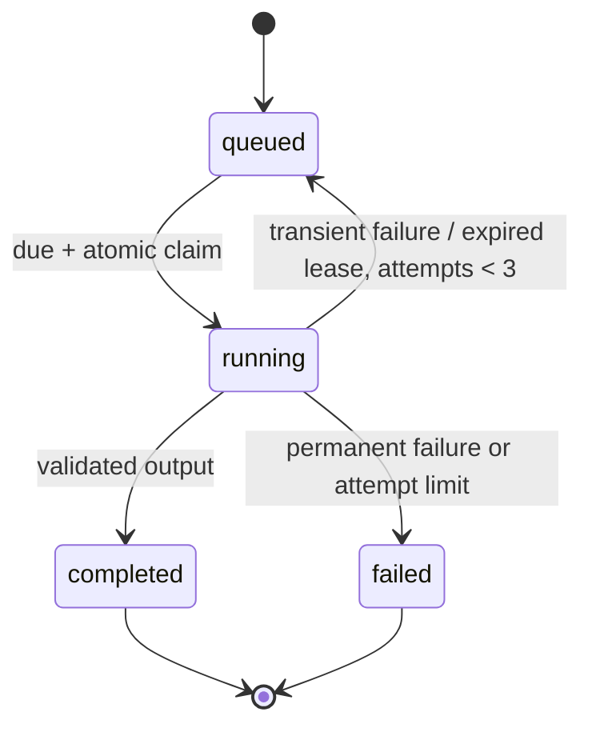

# Architecture and decisions

## Request lifecycle

`POST /api/sessions` validates the resume, role, and level and atomically inserts a session plus a plan-generation job. The response is 202 with IDs, so the request does not wait for a model service. Workers claim eligible jobs in `BEGIN IMMEDIATE` transactions. The browser polls the session and displays queue state.

A validated plan contains exactly six questions, sequential IDs 1–6, and two questions in each category. On successful generation, the raw resume is removed from the session input and completed job payload. The resulting questions can still contain resume-derived facts.

An answer is associated with a question stored by the server, never a client-invented question. The unique `(session_id, kind, question_id)` constraint prevents duplicate evaluation jobs. A repeated identical submission returns its job; a different answer to that question receives 409. Evaluations preserve the original question and answer alongside structured feedback. Category summaries are deterministic arithmetic over completed results.

## Queue state machine

Each claim increments the attempt counter and creates a 60-second lease. Completion updates include the attempt number, fencing out stale workers. A crashed attempt can be reclaimed after expiry. Provider calls time out after 25 seconds. Retries use exponential backoff plus jitter and respect provider `Retry-After` up to 120 seconds. That cooldown is shared across workers via the database. Other calls are paced at a minimum of one second between starts. There are two concurrent consumers per worker process by default; these are asynchronous loops, not CPU threads.

Delivery is **at least once**: an interrupted worker may have completed a paid external request before persisting its result. Database deduplication prevents duplicate local evaluations but cannot guarantee exactly-once external billing. Failed jobs remain visible, with machine-readable error codes. There is no unlimited user-triggered retry endpoint.

## Why SQLite instead of Redis + Postgres?

One durable local database provides sessions, job scheduling, and atomicity without three services for a portfolio deployment. WAL permits readers alongside a writer, and indexed status/due-time selection bounds scheduling queries. API submission guards bound the pending backlog to 100 jobs and each browser to 30 sessions. Limits on file size, PDF pages, input text, and output schemas control workload size.

The tradeoff is a single writer and local-disk deployment. Synchronous DB operations are intentionally small; heavy OCR executes in browser workers and model calls use async I/O. The API rate limiter is process-local and signaling rooms are in memory, so multiple API replicas are not supported by this configuration. Do not mount the WAL database on a shared network filesystem.

A measured scaling path is Postgres for session data, a durable broker for jobs, shared rate limiting, object storage for encrypted artifacts if needed, and a shared signaling adapter. Establish load/latency targets and benchmarks before claiming scale. No fabricated throughput or latency benchmark is included.

## Evaluation boundary

The provider receives a system instruction and JSON-encoded user data. System instructions explicitly treat resumes and answers as untrusted input; the model has no tools or ability to execute code. Strict response schemas are requested and server validation is authoritative. Malicious embedded instructions can still influence a model's coaching text; output schemas are a structural safeguard, not a semantic guarantee.

The live evaluator uses relevance (30), technical accuracy (30), specificity (25), and clarity (15) to request a total score out of 100. Scores are not independently calibrated. Demo mode returns a fixed 65-point illustration and clearly states that it does not assess performance. Stored sessions carry their mode; a later configuration change cannot cause pending demo resumes to be sent to a live provider.

## Media and OCR

PDF text extraction runs locally; pages with fewer than 30 extracted characters fall back to rasterization and OCR. Pages are capped at 2,000 pixels on the longest edge. English OCR loads public Tesseract assets on demand. Image resumes use the same OCR worker. Worker resources are terminated after extraction, and the PDF loading task is destroyed on success or failure.

Camera preview requests video only. A practice room requests audio and video only after the user clicks its button. Rooms have 128-bit random invitation capabilities, a two-person cap, an hour lifetime, message-size limits, and per-socket event limits. Signaling uses WebSocket transport with origin checks; WebRTC transports the media. Leaving/unmounting stops tracks and closes the connection. Camera frames never go to the model service. Browser speech recognition is a separate API and may send audio to the browser vendor.

## Persistence and deletion

Schema version 1 is initialized idempotently. Every job belongs to a session with an enforced cascading foreign key. Seven-day cleanup runs on startup and every five seconds in an active worker. Deleting a session prevents in-flight results from recreating data, but it cannot cancel information already sent to an external model. Database backups require their own retention policy. Use the online backup command rather than copying only the main database file during WAL activity.
